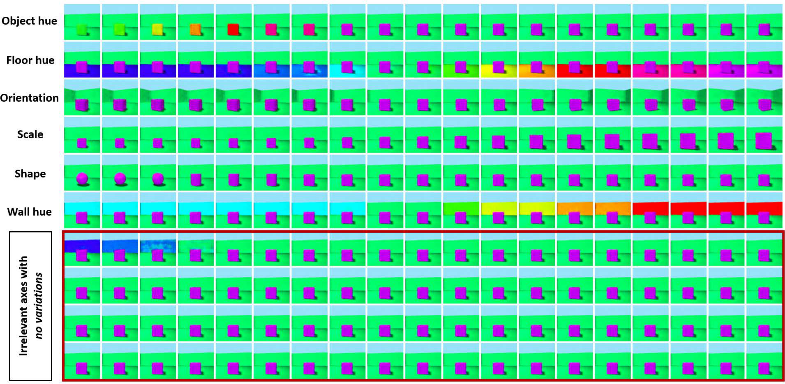

# ARD-VAE — Reproduction

A reproduction of the WACV 2025 paper **"ARD-VAE: A Statistical Formulation to Find the Relevant
Latent Dimensions of Variational Autoencoders"** by Surojit Saha, Sarang Joshi and Ross Whitaker
(University of Utah).

- Paper: https://arxiv.org/abs/2501.10901
- Original code: https://github.com/Surojit-Utah/ARD-VAE

---

## What the paper is about

A VAE squeezes an image through a bottleneck of `L` numbers (the *latent dimensions*) and then
rebuilds it. The catch: **nobody knows what `L` should be.** Too small and the model loses detail;
too large and most dimensions sit unused. In practice `L` is guessed and tuned by trial and error.

**ARD-VAE makes the model figure out `L` by itself.** You start with a deliberately oversized
bottleneck, and during training the useless dimensions quietly shrink to near-zero while the useful
ones stay large. Afterwards you just count the ones that survived.

It does this by changing **one thing** — the prior. A normal VAE pushes every dimension toward the
same fixed spread. ARD-VAE instead lets each dimension learn its own spread from the data, and the
maths behind it (an ARD / Gamma prior) naturally drives unneeded ones to zero. Nothing else about
the VAE changes: same architecture, same loss, no extra knobs to tune.

<p align="center">
  
</p>

<p align="center"><em>Each row nudges one latent dimension. The <strong>relevant</strong> ones visibly
change the image; the <strong>collapsed</strong> ones do nothing — which is how the useful
dimensions are identified.</em></p>

---

## What we did, and how it differs from the paper

We reproduced the paper's main experiment (**Table 2**: MNIST and CIFAR-10) from the authors' code.

**Changes we had to make:**

| | Paper | Ours | Why |
| --- | --- | --- | --- |
| CIFAR-10 training | 100 epochs | **30 epochs** | The whole pipeline had to fit one ~4 h Kaggle session |
| Hardware | — | 2x NVIDIA T4 (Kaggle) | All 10 runs share one queue across both GPUs |
| Precision | float32 | float32 | We tried FP16 (~2.5x faster) but CIFAR-10 runs blew up to NaN |
| Precision/recall code | used in paper | **written by us** | The released code doesn't include it |

We also updated the original code to run on the current TensorFlow/Keras version, sped up the
active-dimension calculation, and added ready-made configs for the Table 2 setup.

**Results** (5 seeds each, "Active" = dimensions the model actually kept):

| | MNIST Active | MNIST FID | CIFAR-10 Active | CIFAR-10 FID |
| --- | ---: | ---: | ---: | ---: |
| Paper | 12.80 | 22.24 | 105.80 | 87.56 |
| Ours | 13.00 | 34.73 | 103.60 | 94.94 |

**The main claim reproduces.** The model found essentially the same number of useful dimensions as
the paper on both datasets. Image quality (FID) is somewhat worse, which is expected from the
shorter training. Our precision/recall numbers came out far below the paper's; since that code is
our own addition, we treat it as a problem with our measurement, not with the model, and don't
report it as a result.

---

## Setup

Needs Python 3.9+ and a GPU (it will fall back to CPU, slowly).

```bash
git clone https://github.com/Param45/ARD-Variational-Autoencoder.git
cd ARD-Variational-Autoencoder
pip install -r requirements.txt
```

MNIST and CIFAR-10 download themselves on first run.

**Train one model** (`--config_id 3` = MNIST, `4` = CIFAR-10; `--run_id` is the random seed):

```bash
python Main.py --run_id 1 --config_id 3
```

Results land in `logs/{dataset}/Dim_{L}/Run_{run_id}/`.

**Evaluate** (FID, precision/recall, and how many dimensions survived):

```bash
cd eval/study_fid/compute_fid
python prepare_fid_stats.py --dataset ALL --out_dir fid_stats --samples 10000

cd ../generate_samples
python generate_samples.py --config_id 3 --latent_dim 16 --gen_type generation --eval_ids 1 2 3 4 5

cd ../compute_fid
python compute_n_plot_fid.py --config_id 3 --latent_dim 16 --gen_type generation --eval_ids 1 2 3 4 5
```

**Or skip all of that** and open
[`ARD_VAE_Kaggle_Table2_Replication.ipynb`](ARD_VAE_Kaggle_Table2_Replication.ipynb) — it runs
everything end to end on Kaggle and prints the final comparison table. It's safe to re-run:
finished training runs are skipped.

---

## Folder structure

```text
ARD-VAE/
├── Main.py                  # Start here — trains one model
├── ARD_VAE_Kaggle_Table2_Replication.ipynb   # The full reproduction, start to finish
├── config/                  # Settings per dataset (latent size, epochs, learning rate...)
├── data/                    # Loads MNIST / CIFAR-10 / CelebA
├── models/                  # The encoder and decoder networks
├── loss/                    # The ARD loss — this is where the paper's idea lives
├── train/                   # The training loop
├── lr_schedular/            # Learning-rate schedule
├── eval/study_fid/          # Scoring: FID, precision/recall, counting active dimensions
├── util/                    # Plotting and file helpers
└── images/                  # Figures used in this README
```

---

## Credits

The method and the original implementation belong to the paper's authors:

```bibtex
@inproceedings{saha2025ardvae,
  title     = {ARD-VAE: A Statistical Formulation to Find the Relevant Latent Dimensions of Variational Autoencoders},
  author    = {Saha, Surojit and Joshi, Sarang and Whitaker, Ross},
  booktitle = {IEEE/CVF Winter Conference on Applications of Computer Vision (WACV)},
  year      = {2025}
}
```

Reproduction by **Ankesh Mishra, Devansh Adhini, Param Sonawane, Vedaang Narkhede** —
IIIT Vadodara, CS433 (Group 2).
